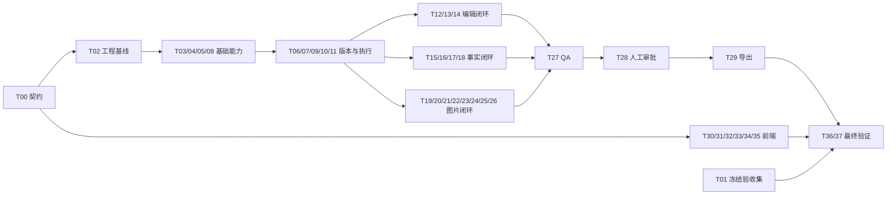

# AI Editorial Agent：多 Agent 执行与审核计划 v1.0

日期：2026-10-02（Asia/Hong_Kong）  
需求基线：[AI-Editorial-Agent-SRS-v1.0.md](AI-Editorial-Agent-SRS-v1.0.md)  
当前状态：已拆解，尚未派发、编码或验收。项目当前仅有需求文档，尚无应用骨架，也未初始化 Git。

## 1. 如何使用这份计划

本计划包含 **38 个可单独派发的任务包（T00–T37）**。每包有唯一负责人、输入依赖、文件边界、执行步骤、交付物和验收条件。执行 agent 完成实现和自测后提交给主 agent；**主 agent 负责代码审核、契约一致性审核、集成和最终验收**。开发审核不替代产品中 Owner 的人工内容批准，也不替代需求要求的业务/版权决策。

“独立执行”表示：契约冻结后可以在自己的文件范围内用固定夹具完成开发和测试，不要求所有任务没有依赖，也不表示可以同时合入未经集成的代码。表中的“依赖”指正式集成前必须通过审核的上游；上游只有接口时，可以先开发，但只能报告“契约自测完成”，不能报告“集成通过”。

原需求优先于本计划；本计划细化工程分工，不降低任何 P0、事实、版权、预算或审批门禁。文中的服务接口名称是待 T00 冻结的建议，不是已经存在的代码。供应商接口、模型能力、版本支持和价格在实施时查官方资料并用受控探针核对，本次拆解不代表这些事项已验证。

### 统一交付约定

1. 默认采用 SRS 的 Java 21、Spring Boot 3.5 兼容基线、PostgreSQL、Vue 3/TypeScript、模块化单体；具体补丁版本由 T02 留下核验记录。单一 Maven application，不按任务数拆微服务。
2. 所有 agent 先读 SRS 第 5–6、16、25–29、32–36、38 节，再读任务卡的专项章节；先检查上游审核状态和契约版本。
3. 后端以 `backend/src/main/java/com/example/editorial/` 为包根，下文简写为 `BE/`；前端根简写 `FE/ = frontend/src/`。单元/集成测试放相应测试目录，与生产代码所有权一致。
4. 每包按卡片中编号顺序执行，可将编号项作为独立提交。遇到合同缺口先提交变更说明，不自行更改其他 agent 的 DTO、表或公共配置。
5. 默认离线 mock 开发。真实收费调用必须先具备凭证、已确认预算、成本预占与对账能力；未具备时交付测试入口和待验证项，不伪造探针结果。
6. 提交 `docs/execution/reports/Txx.md`：改动、契约版本、测试命令及退出码、演示步骤、已知问题、真实/mock 模式、数据库迁移与回滚/恢复影响。未运行的检查标明原因。
7. 主 agent 的结论只有 `PASS / CHANGES_REQUIRED / BLOCKED`。自测通过不能自行将任务标成最终完成。

### 并行开发的文件规则

| 共享区域 | 唯一维护者 | 其他 agent 的提交方式 |
|---|---|---|
| SRS、ADR、公共 DTO/事件/Schema、OpenAPI | T00，之后由主 agent 维护基线 | 提交契约变更申请，获审核后再依赖新版本 |
| `pom.xml`、`package.json`、锁文件、主应用配置、CI | T02；集成阶段由主 agent 接管 | 在报告中提出依赖或配置项，统一合入 |
| Flyway 总序与跨域 FK | 主 agent | 任务作者交付自己表的迁移草案；集成时分配下一全局版本号并空库验证 |
| 前端 router、公共布局、生成 client、全局 store | T30；后续由主 agent 集成 | 交付 feature 的 route/store 导出，避免同时编辑根注册文件 |
| 工作流注册与跨域事件订阅 | T10/T11 各自拥有注册/失效逻辑；主 agent 集成 | 各域提供步骤实现或适配器，不直接改调度器 |
| 夹具 | T01 拥有索引与冻结基线 | 新样例放 `tests/fixtures/<domain>/Txx/`，由 T01/主 agent 纳入索引 |
| 图片公共类型及接口 | T00 冻结，T19 落实接口实现边界 | T20–T25 各占子包，不修改别人的 Provider 或图片流程 |

在正式派发前，由 T02 建立 Git 基线。后续 agent 使用独立分支/工作树；未建立隔离环境时，只允许写入互不重叠目录。禁止覆盖他人未提交修改。迁移脚本一旦执行并合入，不改旧文件，通过新迁移修正；执行新迁移前检查 FK 拓扑，不能简单按任务编号排序。

## 2. 契约先行与待澄清项

T00 至少冻结以下接口边界，返回值必须有版本、归属、hash、stale、错误和审计语义；不能只定义 Java 方法名。

| 契约 | 提供者 → 消费者 | 必须明确的内容 |
|---|---|---|
| `ActorContext / Ownership / AuditSink` | T03 → 所有域 | actor 来自认证，Worker 不可人工批准，跨文章引用拒绝 |
| `ArticleSnapshot / VersionCommand` | T06/T07 → 编辑、事实、图片、QA | AST、Unicode 码点、title 锚点、baseVersion、ETag、候选提交 |
| `SkillSnapshot / PolicySnapshot` | T05 → 所有执行域 | 不可变版本、Prompt 绑定、规则 hash、禁止降低硬政策 |
| `WorkflowStep / Command / ManualTask` | T10/T11 → 领域步骤 | 逻辑 key、attempt、lease、fencing、deadline、恢复及等待语义 |
| `BudgetReservation / Settlement` | T08 → T09、检索和图片 Provider | 原子预占、文章/日预算、UNKNOWN、取消后结算 |
| `AIRequest / AIResult / ToolCall` | T09 → 编辑、核验、视觉、生图 | 能力路由、拒绝/截断/受理未知、Schema/语义双校验 |
| `SourceSnapshot / FactSet` | T15/T16/T17/T18 → Writer、QA | 精确摘录、限定条件、独立性、版本关联、时效与失效通知 |
| `ImageProvider / LicenseDecision / Variant` | T19–T25 → 配图、Manifest | 三值许可、用途、评分、人工选择、最终变体 hash/水印 |
| `Manifest / ReleaseCandidate / Approval` | T26–T28 → 导出 | canonical hash、冻结输入、警告处置、事务内复核、历史有效性 |
| `ObjectStore / SafeFetch` | T04/T15 → 所有文件使用方 | 暂存提交、受权下载、SSRF、大小/像素限制、孤儿清理 |

以下是需求文档的工程落点缺口，交给 T00 形成 ADR；不擅自删除要求或扩展 MVP：

- 第 33 节要求明确删除文章，但第 29.2 节无删除/影响预览接口。由 T00 提交最小接口补充，T06/T04/T37 实现业务删除、对象清理、保留策略；归档不能冒充删除。
- 标题、副标题、图注和图片可读文字都要核查，但图片文字的提取与不可读回退未给步骤。T00 定义图片文字提取结果契约；T18 负责对当前 selection/最终变体提取并关联 Claim，无法可靠读取时生成人工待办。此能力不等于新增 PDF/OCR 原文导入。
- `image_selection` 的内容需不可变，但 `active` 可切换；T00 明确只允许切换活动标志，图注/变体修改创建新 selection，旧版本不得覆盖。
- 已发布配置与草稿、不可变产物与可变处置的数据库权限不同；T00/T02 定义各表权限，禁止一刀切禁止全部配置表 UPDATE。
- `ArticleJob.original/currentVersionId` 在同一创建事务内回填，T06 必须保证事务提交时完整；T00 明确同文章复合 FK 及循环引用的迁移顺序。
- 第 38.1 节的两名独立人工标注者、模型质量人工评分，以及第 40 节业务决策不能由开发 agent 声称已完成。T01/T37 保存责任人、证据和未完成状态。

## 3. 执行批次和审核关口

下表是资源受限时的推荐批次，任务卡依赖具有最终约束力。后续批次的纯函数、UI 和 Provider 实现可在契约冻结后提前用 mock 开发。

| 批次 | 任务 | 主 agent 的退出审核 |
|---|---|---|
| A：基线 | T00；T01 可同时准备素材与标注规范 | G0：合同覆盖全部接口/状态/表，缺口有决定或显式待办 |
| B：基础设施 | T02；完成后并行 T03、T04、T05、T08、T30 | G1：可启动，认证、私有存储、固定配置、预算底座可验证 |
| C：执行与版本 | T06 → T07；T09；T10 → T11 | G2：幂等、租约、恢复、人工并发保护通过 |
| D：内部编辑闭环 | T12 → T13 → T14；T31；T35 的配置/成本入口 | G3：附录 J 的 8 步演示通过，仍只允许内部未批准草稿 |
| E：事实闭环 | T15、T16 → T17 → T18；T32 | G4：生产顺序恢复为先核验再写作，新增事实和失效能阻断 |
| F：图片闭环 | T19；T20/T21/T22/T23 并行；T24/T25 → T26；T33 | G5：两图库、人工选择、许可、水印、声明全部集成 |
| G：审核交付 | T27 → T28 → T29；T34；T35 完成监控 | G6：固定快照审批和正式 ZIP 全链路一致 |
| H：最终验收 | T36、T37；T01 完成金标和质量证据 | G7：AC-01–35、NFR、真实探针及上线决策全量复核 |



图仅展示主链；下方卡片是精确依赖。前端可与后端并行开发，必须在对应关口连接真实后端验收。建议同时安排 2–3 个实施 agent，主 agent 保留审核容量；任务包数量不等于必须同时启动 38 个 agent。

## 4. 可派发任务卡

所有卡片均须提交统一报告；“验收”是该包的关键检查，不免除 SRS 关联章节的其他要求。

### T00 — 架构、API 与跨域契约

- 依据：第 16、25–29、40 节，附录 C/F；依赖：无。
- 写入：`docs/adr/`、`docs/api/openapi.yaml`、`docs/schemas/`、`docs/execution/contracts/`。
- 步骤：①登记 OQ 默认值及未确认项，处理第 2 节缺口；②定义 AST、Agent 输出、错误、分页、ETag、幂等与领域 DTO；③把第 29.2 节完整落为 OpenAPI，建立 38 表归属及 FK 图；④固定状态守卫、依赖事件、hash 序列化和 mock 样例。
- 交付：ADR-001 架构、ADR-002 事实政策、ADR-003 图片政策及必要补充；可校验 OpenAPI/Schema；模块所有权表。
- 验收：Schema 正反例可验证；每个 SRS API 有对应 operation；依赖图无环；无任意修改 status 或模型批准入口。各调用方能只看契约写测试。

### T01 — 验收数据、金标与评测规范

- 依据：第 38 节；依赖：可立即准备，契约夹具基于 T00。
- 写入：`docs/evaluation/`、`tests/fixtures/` 的索引和基础样例。
- 步骤：①准备有使用依据的 20 篇五类文章及恶意/超长输入；②组织至少 200 个主要 Claim 的双人独立标注、分歧复核；③构造全部许可、Provider 错误和并发失败夹具；④实现召回、精确率、错误支持数、编辑量表和三次运行成本报告工具。
- 交付：带 hash/来源/权利依据的冻结数据索引、机器夹具、人工标注表、评测说明。人工尚未标注的记录必须标 `UNREVIEWED`。
- 验收：fixture 不含真实密钥/无权保存全文；指标可重算；CRITICAL 漏检逐例列出；合成数据不冒充人工金标。贯穿 AC-01–35，不以本包代替业务实现测试。

### T02 — 工程骨架与可重复启动

- 依据：第 27、32–33 节，附录 G/J；依赖：T00。
- 写入：`backend/`、`frontend/` 的空骨架和构建文件、`infra/compose.yml`、`infra/env.example`、CI、根 `README.md`；交接后不再修改各领域内容。
- 步骤：①初始化 Git/忽略规则，锁定并记录运行时与依赖维护来源；②建单体后端、Vue 工程、PostgreSQL/Flyway；③区分迁移/运行账号、dev/mock/prod 配置；④建立构建、类型检查、契约检查、密钥/依赖扫描和一条启动入口。
- 交付：可启动空应用、配置说明、CI 基线、迁移命名规则。
- 验收：从空数据库启动；迁移重复运行不损坏；生产关闭自动建表且拒绝 mock；未配置真实 Provider 时显示缺失能力，不假装可用。

### T03 — 登录、所有权、公共错误与审计

- 依据：第 5、29.1、33–34 节；依赖：T02。
- 写入：`BE/identity/`、`BE/audit/`、T00 指定的 `BE/shared/` 基础类型和请求幂等组件；拥有 `app_user`、`audit_log`、`idempotency_record`。
- 步骤：①初始化单 Owner 和独立 SystemUser；②实现 Session/CSRF、密码哈希、登录限流和退出；③提供 ActorContext、所有权验证、统一错误/trace；④实现追加审计及脱敏；⑤实现可加入业务事务的请求幂等记录，同 key 同内容复用、异内容 409，供文章创建与工作流命令复用。
- 交付：认证 API、资源权限接口、审计查询接口与日志约定。
- 验收：AC-33；另一 owner/匿名/伪造 actor 请求被拒；Worker 无人工批准能力；登出会话失效；日志不泄漏正文和密钥。第二 owner 仅用于隔离测试，不新增团队产品。

### T04 — 私有对象存储与安全下载

- 依据：第 25.3、31–35 节；依赖：T02、T03。
- 写入：`BE/storage/`、存储集成测试、`infra/` 下独立存储配置片段。
- 步骤：①实现 Local/S3 的 PUT/GET/HEAD、hash/大小元数据；②实现暂存→校验→引用提交协议；③实现所有权下载、5 分钟签名链接、原始素材权限；④按引用和 TTL 清理孤儿并提供删除/保留接口。
- 交付：ObjectStore 接口两种适配器、清理任务、受权下载能力。
- 验收：AC-29/32；对象成功而 DB 失败不产生业务成功；24 小时后仅删无引用孤儿，历史审批引用不误删；路径穿越拒绝；S3 能力缺失明确报告。

### T05 — Skill、Prompt 和政策版本

- 依据：第 10、26、29 节；依赖：T02、T03。
- 写入：`BE/editorial/skill/`、`BE/settings/policy/`、内置 Skill/Prompt 资源；拥有 `editorial_skill`、`editorial_skill_version`、`policy_version`、`prompt_version`。
- 步骤：①创建内置 WechatEditorialSkill 及四个编辑 Prompt 基线；②实现复制草稿、JSON 校验、发布、停用；③生成 StyleSnapshot、规则/Prompt hash；④校验 Skill 不降低平台硬政策。
- 交付：Skill API、政策/Prompt 读取服务、固定快照及版本 diff。
- 验收：AC-02；发布后不可覆写，停用不破坏旧任务；更换 Skill 发出配置变更事件，由 T11 创建新运行并失效下游；恶意规则无法关闭硬门禁。

### T06 — ArticleJob、原文、AST 与任务管理

- 依据：第 6、9、16.1、26、29、33 节；依赖：T03、T04、T05；同步创建幂等使用 T03，异步删除/生成输入变更在 G2 接入 T10/T11。
- 写入：`BE/article/job/`、`BE/article/ast/`；拥有 `article_job`、`article_version` 的基础模型和创建逻辑。
- 步骤：①实现粘贴/TXT/Markdown、100–30,000 码点与 1MB 校验；②同事务写 Job/Original/快照，验证使用依据；③实现 AST 白名单、稳定块 ID、纯文本与 canonical hash；④提供列表、详情、设置修改、克隆、归档和经 T00 定义的明确删除命令。
- 交付：文章 API、输入解析器、跨文章 FK/提交完整性约束、删除影响清单与异步清理入口。
- 验收：AC-01；无半成品 Job、Original 不变、客户端 actor 不被接受；HTML/非法格式拒绝；生成输入修改走 T11，单纯加预算不改正文。任务取消后仅可克隆继续。

### T07 — 版本、Diff、恢复和修改提案

- 依据：第 14–16、24 节；依赖：T06、T10、T11。
- 写入：`BE/article/version/`、`BE/article/proposal/`；拥有 `change_proposal`，通过 T06 约定的版本写入口创建版本。
- 步骤：①实现人工保存、If-Match/baseVersion、block 拆并映射；②实现任意两版 diff、RESTORE 新版本；③实现提案接受/拒绝；④提交人工修改前使旧执行 fencing 失效，晚到 AI 保存候选/历史。
- 交付：版本/提案 API、并发保护、事件发布。
- 验收：AC-19/20/23/25；缺 ETag=428、旧 ETag=412；恢复不复活旧 QA；同一提案重复接受只有一个业务结果；原文和历史不覆盖。

### T08 — 预算、价格、用量与对账

- 依据：第 32.2–32.3、34–35 节；依赖：T02、T03；以 T00 定义的 article/execution ID 契约开发，FK 在 T06/T10 后集成。
- 写入：`BE/cost/`；拥有 `cost_ledger`。
- 步骤：①定义 decimal 金额、价格版本、ESTIMATED/ACTUAL；②实现文章/日预算、Provider 配额与次数上限的原子预占；③实现幂等结算、释放差额及 UNKNOWN 对账；④输出 usage API 和预算告警数据。
- 交付：BudgetService、价格配置、账本、对账命令/查询。
- 验收：AC-28；最后余额竞争只放行一方；取消/暂停不免除已发生费用；未知费用保留预占、未知价格禁止自动生图；推理 token 不重复计费。

### T09 — AI 网关、能力路由与调用追踪

- 依据：第 11、31.1、34–35 节；依赖：T03、T04、T05、T08。
- 写入：`BE/ai/`、`BE/settings/provider/`；拥有 `provider_config`、`agent_execution`、`tool_execution`。
- 步骤：①实现 mock 与真实 Responses Adapter、text/vision/search/generation 能力接口；②处理 Schema、refusal、incomplete、截断、业务引用校验钩子；③限制工具白名单/参数及最多 8 次调用；④保存请求/结果对象引用、用量、trace、providerRequestId，提供受控能力探针。
- 交付：AI Gateway、Provider 设置/探针/执行详情 API、固定响应契约测试。
- 验收：AC-27/30；合法 JSON 的非法引用仍失败；纠正调用最多一次且计预算/总尝试；受理未知不盲重发；请求数据不升级为系统指令。探针是否真实成功单列报告。

### T10 — 持久化调度、命令幂等与恢复

- 依据：第 25、29.1、32、35 节；依赖：T03、T04、T06；可先用无外部调用的测试步骤。
- 写入：`BE/workflow/engine/`、`BE/workflow/command/`；拥有 `workflow_execution`、`workflow_step_execution`，复用 T03 的请求幂等组件。
- 步骤：①实现原子写命令/幂等记录/运行/步骤/审计、202 与统一 operations 查询；②实现 PG SKIP LOCKED、有界线程池、单文章串行与两文章并发；③实现 60 秒租约/15 秒续租/fencing、短事务提交；④实现逻辑 key/attempt、退避、deadline、失租恢复及 SSE 游标。
- 交付：步骤 SPI、Worker、统一命令总线、operations/SSE/查询 API；ExportArtifact 解析预留给 T29 注册。
- 验收：AC-21/22/23；成功输入相同不重复调用；旧 Worker 不能提交；最多 50 篇排队；任何网络调用不占用长 DB 事务；受理未知交给对账而非通用 retry。

### T11 — 依赖失效、人工等待与流程控制

- 依据：第 16.2、24–25、35 节；依赖：T05、T06、T10。
- 写入：`BE/workflow/dependency/`、`BE/workflow/manual/`；拥有 `manual_task`。
- 步骤：①按第 25.1 节实现全部状态守卫和 resumeTarget；②实现 pause/resume/cancel/retry 与持久化人工任务；③按标题/正文/图注/图片/来源/政策变更计算最小重跑集合；④提供各域的失效通知 SPI，保留历史，重新验证后恢复。
- 交付：DependencyResolver、状态/失效矩阵、控制与待办 API。
- 验收：AC-20/24/25/31；暂停取消后的响应只记费用与历史；CANCELLED 不恢复；缺证据不会被技术重试自动解决；换图片不会重跑未变正文事实；生产状态无跳过硬门禁入口。

### T12 — Analyzer 与长文分块

- 依据：第 10–11、35、38 节；依赖：T05、T06、T09、T10。
- 写入：`BE/editorial/analyzer/`；拥有 `analysis_result`。
- 步骤：①落地完整 Analysis Schema 和输入快照；②实现锚点/小节/枚举/数值验证；③实现上下文预算内分块及全局合并；④注册 ANALYZE 和分析查询 API。
- 交付：只读分析步骤、结构问题/建议/Claim 草案，不生成最终稿。
- 验收：AC-03/30；所有 span 与 quote/hash 匹配，30,000 字尾部不丢；Unicode 补充字符不偏移；人工质量指标由 T01 验证，结构通过不等于质量通过。

### T13 — RewritePlan 与 Writer V1

- 依据：第 14、25，附录 J；依赖：T07、T09、T10、T12；正式生产还依赖 T17。
- 写入：`BE/editorial/writer/`；拥有 `rewrite_plan`。
- 步骤：①固定 original/skill/analysis/factSet 输入并形成删除/改写计划；②生成 AST V1、引用、摘要及待核新事实；③调用版本服务提交或保存候选，并实现 regenerate-section 异步命令，限定 block/事实集后产生 T07 的 Proposal；④注册 BUILD_REWRITE_PLAN/WRITE，区分内部草稿模式与正式事实前置条件。
- 交付：生成 API、计划与 V1、目标字数提示。
- 验收：AC-05/20/30；不能伪造 sourceId，模型新增事实不可自动 SUPPORTED；内部草稿 Claim 均待核，正式批准/导出返回 FEATURE_NOT_READY；无自动覆盖人工头。

### T14 — Reviewer 与 Writer Revision V2

- 依据：第 15、25，附录 J；依赖：T07、T09、T10、T13。
- 写入：`BE/editorial/reviewer/`、`BE/editorial/revision/`；拥有 `review_report`、`review_item`。
- 步骤：①独立 AgentName/Prompt/执行记录输出 ReviewReport；②实现逐项采纳/拒绝/理由；③生成 V2 和 ACCEPTED/ALTERNATIVE/NOT_APPLIED 对应关系；④注册 EDITORIAL_REVIEW/REVISE，触发 T18 对新稿重核。
- 交付：审稿/修订/意见处置 API；默认仅一次自动编辑循环。
- 验收：AC-06/07；Reviewer 不改正文；跨版本 report 拒绝；拒绝 FACT_RISK 意见不能关闭事实门禁；V3 必须用户触发。

### T15 — 受控检索、网页读取与 Source Ledger

- 依据：第 12–13、31–35 节；依赖：T03、T04、T08、T09、T10。
- 写入：`BE/research/`；拥有 `source`、`source_snapshot`，提供公共 SafeFetch 接口。
- 步骤：①实现搜索只发现来源、HTTPS 正文取回；②解析后/连接目标及每次重定向校验地址，防私网/IPv6/DNS rebinding；③保存合法摘录、locator、hash、rightsBasis、独立性资料与新快照；④实现手工来源、刷新、撤稿/访问失败事件。
- 交付：Source API、SafeFetch、SourceSnapshot 与缓存/限额机制。
- 验收：AC-04/24/26/27；搜索摘要不可当正式证据；日期未知为 null；不绕过付费墙；暂不可达与撤稿分开；旧快照不可覆盖。

### T16 — Claim 提取、定位与数字漏检补充

- 依据：第 12.1、16、38.1 节；依赖：T06、T09、T10。
- 写入：`BE/factcheck/extraction/`；拥有 `fact_claim` 基础持久化。
- 步骤：①提取原子命题及 subject/qualifiers/importance；②覆盖标题、副标题、正文及外部传入 selection 文本；③扫描数字/日期/单位/引号/实体补漏，不能建 Claim 的生成阻断；④保持 logicalClaimId 与具体版本/selection 关联分离。
- 交付：Claim 提取服务、scope/anchor 校验、查询 API。
- 验收：AC-04/07/30；不丢地域/时间/研究类型；主要事实标注集召回≥95%、精确≥90%，CRITICAL 漏检逐例整改；模型 confidence 不是通过依据。

### T17 — 证据规则、事实核验与人工补证

- 依据：第 12.2–13、23 节；依赖：T11、T15、T16。
- 写入：`BE/factcheck/verification/`；拥有 `fact_verification`、`claim_source`。
- 步骤：①校验摘录存在及数值/单位/限定词；②实施 A 来源或两个独立 B 来源、时效与高风险人工复核规则；③保留反证/冲突，创建人工待办；④实现核验/重核/人工证据 API 和供 Writer/QA 使用的 FactSet。
- 交付：VERIFY_FACTS、版本化证据政策、事实处置与快照。
- 验收：AC-04/24；转载不能充当独立来源；无证据/被反驳命题在冻结集错误 SUPPORTED=0；加“可能”不解除阻断；明确删除方案可写草稿，正文仍保留无证据重要事实则禁止最终通过。

### T18 — 全稿增量核验与图片文字事实

- 依据：第 12、16.2、23、25 节；依赖：T11、T16、T17；图片部分最终联调依赖 T24。
- 写入：`BE/factcheck/reconciliation/`，复用其他 factcheck 服务，不修改其表语义。
- 步骤：①对 V1/V2/人工/恢复版本重新提取全部 Claim；②仅在命题、上下文与未过期证据完全匹配时复用并生成新版本关联；③提取 selection 图注/最终变体可读文字，定位框/hash 与事实关联；④接入来源撤稿、政策变更和时间失效，推进最小重跑。
- 交付：RECONCILE_FACTS、图片文字提取/人工回退、失效传播适配器。
- 验收：AC-07/24/25；改一个数字必重核；标题和图注独立变化可被捕获；图中文字不确定不静默略过；事实补核完成不循环重做配图。

### T19 — ImageSlot 规划与图片 SPI

- 依据：第 17–18、25 节；依赖：T06、T09、T10；正式规划依赖当前稿通过 T18。
- 写入：`BE/image/planning/`、已冻结的图片 SPI；拥有 `image_slot`。
- 步骤：①实现按篇幅/目的规划及稳定块锚点；②实现 Slot 修改、重绑定和可选删除；③定义 Provider 注册、能力检测和搜索批次接口；④注册 PLAN_IMAGES，合法无图计划可跳到组装审核包。
- 交付：规划/Slot API、ImageProvider/GenerativeImageProvider 接入点。
- 验收：AC-08；EVIDENCE/mustBeReal 禁生图；相邻图有正文隔开；删除锚点标 STALE；SCENE 改示意必须显式改用途；不靠凑数制造图片。

### T20 — Wikimedia Commons Adapter

- 依据：第 18–19、31 节；依赖：T08、T15、T19。
- 写入：`BE/image/provider/commons/`、Commons 自有测试夹具。
- 步骤：①实现搜索/Imageinfo/分页/限流；②保存文件页、修订、作者和原始多许可元数据；③通过 SafeFetch 提供元数据/证据/下载；④实现缺字段、429、部分失败固定响应测试及受控真实探针。
- 交付：Commons Provider，不自行授予许可或选图。
- 验收：AC-09/26；缺许可返回未知，作者不自动取上传者；HTML 元数据转文本；失败不丢其他 Provider 结果；真实探针证据单列。

### T21 — Pexels Adapter

- 依据：第 18–19、31 节；依赖：T08、T15、T19。
- 写入：`BE/image/provider/pexels/`、Pexels 自有测试夹具。
- 步骤：①实现鉴权、搜索、分页/Retry-After；②分别保存摄影师、个人页、素材页、文件 URL；③记录内容许可和 API 条款两个快照入口；④实现字段缺失/过期下载链接测试及受控真实探针。
- 交付：Pexels Provider 和署名/平台链接元数据。
- 验收：AC-10/26；不假设响应有完整 license；Key 不进浏览器/日志；一方失败可返回另一方结果但显示不完整搜索。

### T22 — 许可解析与硬过滤

- 依据：第 19、23 节；依赖：T03、T04、T05、T19；Provider 数据可用夹具开发。
- 写入：`BE/license/policy/`、`BE/license/evidence/`；拥有 `license_metadata`。
- 步骤：①规范化 nullable boolean 与不可变授权证据；②实现 UNKNOWN/NC/ND/缺作者/商用未知拒用；③实现多许可选择、SA 义务及其他权利人工复核；④实现补证 API、有效期检查与 LicenseDecision。
- 交付：VALIDATE_LICENSES、许可查询/复核 API；不得提供直接写 licenseVerified 的接口。
- 验收：AC-11；null 不转 false/允许；人工“接受风险”不能放行 UNKNOWN；条款/作品许可义务分离；生成图仅用 GENERATED_TERMS。

### T23 — 图片解码、变体和程序水印

- 依据：第 21、32–33 节；依赖：T04、T19。
- 写入：`BE/image/media/`、`BE/image/watermark/`、许可可分发的字体及许可证；拥有 `image_asset`、`image_variant`。
- 步骤：①限制 20MB/40MP、magic/MIME，拒绝 SVG/坏文件并重编码；②实现裁剪/缩放、不可变变体和 transformHash；③最终变换后加精确“AI生成”边角与内部水印；④保存原图/变体/hash/fontHash/参数并复解码。
- 交付：图片变体 API、媒体安全处理、WATERMARK 步骤。
- 验收：AC-14/26；每边裁 10% 至少一处内侧标记；中文字体/glyph 缺失失败；水印失败不 READY；每个新导出变体重水印，原图受控不外发。

### T24 — 搜索编排、评分与人工选择

- 依据：第 18、24、29 节；依赖：T07、T11、T19、T20、T21、T22、T23。
- 写入：`BE/image/search/`、`BE/image/evaluation/`、`BE/image/selection/`；拥有 `image_candidate`、`image_selection`。
- 步骤：①Commons→Pexels 搜索、去重、缓存、按 3 query/20 返回/30 筛选/5 视觉上限执行；②硬过滤后按 SRS 权重评分；③选择时重新检查所有权/用途/许可/变体；④新增 selection 并使旧选择失活，通知 Manifest/QA/事实失效。
- 交付：SEARCH_IMAGES/EVALUATE_IMAGES、候选/选择 API、低分处置。
- 验收：AC-12/25；最高分不自动选中；评分不能抵消许可失败；低分合法图需理由；改图注产生新 selection；视觉分析的变体 hash 与实际评估对象一致。

### T25 — AI 生图、次数上限与对账

- 依据：第 20–21、25.3、32.3 节；依赖：T08、T09、T11、T19、T22、T23。
- 写入：`BE/image/generation/`；拥有 `image_generation`。
- 步骤：①校验用途、allowAutoGeneration 默认 false、每 Slot 2 次/每篇 4 张；②调用生图能力并保存 Prompt、条款、请求 ID 和用量；③受理未知先对账/人工确认；④接下载、水印、候选，等待人工选择。
- 交付：GENERATE_IMAGE、生成 API/历史/对账入口；不提供伪造 SEARCH 能力。
- 验收：AC-13/14/21/28；EVIDENCE/mustBeReal=422；未知受理不重复付费；模型不支持 seed 时为 null；自动建议不等于自动调用，完成生图不等于自动选图。

### T26 — Manifest 和两版版权声明

- 依据：第 22、26、29 节；依赖：T22、T24、T25。
- 写入：`BE/license/manifest/`、`BE/license/notice/`；拥有 `license_manifest`。
- 步骤：①冻结实际选择/最终变体/授权/图注/义务；②用确定性模板生成简洁和完整声明；③校验跨文章引用、顺序/hash 与必需字段；④注册 BUILD_MANIFEST、许可清单查询及重建。
- 交付：不可变 Manifest、两版声明及 hash。
- 验收：AC-15/25；删中间图自动重编号；两版都保留必需署名/许可链接/变更说明；未选图不混入；AI 条款和生成记录不虚构 CC 许可。

### T27 — ReleaseCandidate、Final QA 与警告处置

- 依据：第 16.2、23、25 节；依赖：T11、T14、T18、T26。
- 写入：`BE/qa/`；拥有 `release_candidate`、`qa_report`。
- 步骤：①冻结正文/事实/图片/Manifest/Skill/政策并计算 releaseHash；②实现 QA-01–16 的注册和逐项检查；③实现仅 WARNING 的说明记录与重新出报告；④按最早依赖过期时间/24 小时计算有效期，输出轻量复核接口。
- 交付：FINAL_QA、Candidate/QA API、整改定位。
- 验收：AC-16/25/32；逐个注入 16 项失败，缺检查器必须阻断；BLOCKER 不可降级；无待办/提案/未处置问题才通过；PASS 仅进入 READY_FOR_REVIEW。

### T28 — 人工审批与历史批准有效性

- 依据：第 24、29、33 节；依赖：T03、T07、T11、T27。
- 写入：`BE/review/`；拥有 `human_review`。
- 步骤：①实现显式进入 HUMAN_REVIEW 和固定预览数据；②事务内核对身份、ETag、releaseHash、有效 QA/证据；③追加批准/驳回、警告说明引用；④实现 reopen 和历史批准有效性查询。
- 交付：人工审核/批准/驳回/重开 API、Approval 读取服务。
- 验收：AC-17/23/25；AI/匿名无法批准；并发编辑返回冲突；驳回必有原因、不自动重试；历史 Approval 不删除也不自动套用到新工作头。

### T29 — 草稿预览、正式导出与校验清单

- 依据：第 9、24、29、35 节；依赖：T04、T10、T26、T27、T28。
- 写入：`BE/export/`；拥有 `export_artifact`。
- 步骤：①只从固定 Candidate/Approval 读取，导出前重查时效及文件存在；②确定性渲染 Markdown/安全 HTML；③生成 images、licenses、sources、review-summary、checksums ZIP；④实现异步状态、下载鉴权、过期/撤回阻断及显著未批准的文本预览。
- 交付：导出/预览 API、统一 operations 解析适配器、可反查证据链的包。
- 验收：AC-18/32/35；不混当前工作头；不含密钥、内部 Prompt、未选图、AI 无水印原图；缺文件/过期阻止下载正式包；固定 ZIP 路径防穿越；旧有效批准稿标明历史版本。

### T30 — 前端基础、登录和文章入口

- 依据：第 29–30、33 节；依赖：T00、T02；正式联调 T03、T06、T10。
- 写入：`FE/router/`、公共布局、`FE/api/generated/` 生成流程、公共 store、`FE/features/auth/`、`FE/features/articles/`、`FE/features/dashboard/`。
- 步骤：①生成 API client、统一 CSRF/ETag/幂等/错误处理；②实现登录、Dashboard、列表、新建、详情壳；③实现刷新重建、SSE 断线 3 秒轮询；④交付 feature 注册规范和公共定位组件。
- 交付：完整导航骨架与文章基础操作；Dashboard 后端只读聚合适配器，不跨域写表。
- 验收：AC-01/23/33，NFR-12；键盘可操作；不将长期 token 存 localStorage；显示当前版本/业务状态/运行状态区别；不会伪造精确进度或 ETA。

### T31 — 编辑、分析、Diff 与审稿界面

- 依据：第 30、附录 J；依赖：T30；联调 T07、T12–T14。
- 写入：`FE/features/editor/`、`analysis/`、`versions/`、`reviews/`。
- 步骤：①只读原文与分析锚点定位；②受限 Markdown/块编辑、预览与离开提示；③任意版本 diff、恢复、段落重写提案接受/拒绝；④逐项审稿处置、V2 结果和冲突恢复。
- 交付：附录 J 的编辑工作台，可用 mock 先开发。
- 验收：AC-03/05/06/07/19/20；UTF-16 与码点正确转换；晚到结果不盖掉本地编辑；stale 明确标历史；内部闭环常驻未核验草稿提示。

### T32 — 事实、来源与人工补证界面

- 依据：第 12–13、30 节；依赖：T30；联调 T15–T18。
- 写入：`FE/features/facts/`、`FE/features/sources/`。
- 步骤：①并排展示命题/限定条件/支持和反驳摘录；②展示来源快照、时间、独立性与状态；③接重核、手工来源、删除/改写提案及补证；④覆盖标题、图注、图片文字和失效提醒。
- 交付：事实与证据操作页，不提供“直接设为 SUPPORTED”。
- 验收：AC-04/07/24；可定位原命题和证据；冲突不隐藏；访问失败与命题不成立有不同提示；无权限或待核不靠前端按钮绕过。

### T33 — 配图、许可、生成及水印预览界面

- 依据：第 17–22、30 节；依赖：T30；联调 T19–T26。
- 写入：`FE/features/images/`、`FE/features/licenses/`。
- 步骤：①Slot 拖动排序/绑定/用途和必需状态；②候选分项评分、排除原因、摄影师/平台链接；③明确人工选择、图注、裁剪、生成请求及未知受理提示；④展示许可补证/SA 义务、最终变体水印和两版声明。
- 交付：配图完整交互，所有更改走后端契约。
- 验收：AC-08–15；最高分不默认完成选择；UNKNOWN 无绕过入口；证据位禁生成；明确预览最终水印图；外链安全 rel，供应商 HTML 不直接插入。

### T34 — QA、固定审批预览和导出界面

- 依据：第 23–24、30 节；依赖：T30；联调 T27–T29。
- 写入：`FE/features/qa/`、`approval/`、`exports/`。
- 步骤：①QA 逐项结果和整改定位；②WARNING 填理由、BLOCKER 只能修正；③冻结预览、显式开始/批准/驳回，hash 变动退出旧审核；④当前/历史批准稿和草稿下载入口。
- 交付：人工审核闭环界面。
- 验收：AC-16/17/18/25/32；QA 通过仍不能直接正式导出；历史与当前版本有明确标识；过期/缺对象错误有重核入口；双窗口审批冲突可见。

### T35 — Skill、设置、执行成本与运行监控

- 依据：第 10、30、32、34 节；依赖：T30；联调 T03、T05、T08–T11。
- 写入：`FE/features/skills/`、`settings/`、`executions/`；后端仅 `BE/audit/metrics/` 只读指标适配器和独立监控配置，不改基础审计服务。
- 步骤：①Skill JSON 草稿、diff、发布/停用；②Provider 能力/模型路由/secretRef/额度与受控探针；③步骤 attempt、待办、重试、成本和 UNKNOWN 对账；④指标/trace/告警规则覆盖队列龄期、失租、错误放行、预算和备份失败。
- 交付：设置与运维入口、指标和告警配置。
- 验收：AC-02/28/33/35；大输入输出受权按需加载；不显示密钥/隐藏思维链；区分估算与实际、缺配置与零费用；>80% 预算及 SRS 告警阈值有验证证据。

### T36 — 全链路集成、故障注入与安全性能验证

- 依据：第 32–38 节；依赖：T01、T03–T35 的适用能力；测试设计可从 G1 提前开始。
- 写入：`tests/e2e/`、`tests/integration/`、`tests/performance/`、`docs/execution/verification/`；缺陷修复回交领域负责人。
- 步骤：①实现无图、公开图、AI 图及混合批准导出完整链；②在外部调用前后、对象写入、DB 提交前后杀 Worker；③重放 POST/消息，竞争租约、预算、人工修改/审批；④验证 SSRF/XSS/图片攻击/权限/Prompt Injection，并按基准数据压测。
- 交付：AC-01–35 逐项测试索引、故障时间线、性能报告、缺陷单和复测证据。
- 验收：硬门禁全部通过；NFR-01–07/10/12 实测；实际网络耗时与 mock 性能分报；任何跨版本批准、未知授权放行、无水印正式导出均直接判失败。

### T37 — 部署、恢复、保留删除与上线验收材料

- 依据：第 27、32–33、36、40 节；依赖：T02、T04、T06、T09、T20、T21、T29、T35、T36。
- 写入：`infra/` 的部署/备份/恢复/保留脚本、`docs/runbooks/`、`docs/execution/release-readiness.md`。
- 步骤：①完善 Linux 容器、HTTPS、私有 DB/存储、运行/迁移权限；②执行备份恢复、密钥轮换、UNKNOWN 对账与删除保留演练；③确认真实账号 text/vision/search/generation、两图库和生产对象存储能力；④汇总 OQ 决策、金标质量报告、上线检查及已知限制，提交主 agent 总审。
- 交付：部署包/环境示例、运维手册、RPO/RTO 实测和恢复后 hash 证据、上线就绪清单；本任务不默认执行真实生产上线。
- 验收：AC-34/35，NFR-08/09/11；已批准任务连同对象/证据可恢复；原始 payload 90 天、日志/备份 30 天等策略可验证；月可用率仅在足够观测期后报达标。OQ-04/06/11/12/15/16 等上线项没有明确决定时标“未就绪”。

## 5. 需求覆盖索引

### 功能要求

| FR | 主实施任务 | 界面与集成 |
|---|---|---|
| 01–02 创建/Skill | T05、T06 | T30、T35 |
| 03 分析 | T12 | T31 |
| 04 事实 | T15–T18 | T32 |
| 05–07 写作/审稿/修订 | T13、T14、T18 | T31、T32 |
| 08–10 规划/两图库 | T19–T21、T24 | T33 |
| 11–12 授权/选图 | T22、T24 | T33 |
| 13–14 生图/水印 | T23、T25 | T33 |
| 15 声明 | T26 | T33 |
| 16–18 QA/批准/导出 | T27–T29 | T34 |
| 19 版本/干预 | T07、T11 | T31 |
| 20 可恢复流程 | T10、T11 | T30、T35 |
| 21 观测/成本 | T03、T08、T09、T35 | T35 |
| 22 工作台体验 | T30–T35 | T36 |

### 验收要求（主 agent 全量审核，不以分配归属免检）

| AC | 责任任务 | 必看证据 |
|---|---|---|
| 01 | T06/T10/T30 | 输入边界和幂等创建 |
| 02 | T05/T11/T35 | 配置锁定、换 Skill 失效 |
| 03 | T12/T01/T31 | 完整字段/锚点、人工质量评分 |
| 04 | T15/T16/T17/T01/T32 | 召回精确率、反证/转载/无证据阻断 |
| 05 | T13/T31 | V1、引用、原文不变 |
| 06 | T14/T31 | Reviewer 独立、不改稿 |
| 07 | T14/T18/T32 | V2 逐项处置、新数字再核查 |
| 08 | T19/T33 | Slot 数量、用途、锚点 |
| 09 | T20/T33 | Commons 固定契约及真实探针 |
| 10 | T21/T33 | Pexels 署名/条款/限流及真实探针 |
| 11 | T22/T33 | 三值许可和硬拒用决策表 |
| 12 | T24/T33 | 显式选择、重新校验、旧记录 |
| 13 | T25/T33 | 用途/次数/预算和生成记录 |
| 14 | T23/T25/T33 | 最终变体、水印裁切、缺字体 |
| 15 | T26/T33 | 必需声明、编号、实际选择一致 |
| 16 | T27/T34 | QA-01–16 逐项失败注入 |
| 17 | T28/T34 | 人工身份、固定 hash、原子审批 |
| 18 | T29/T34 | 正式 ZIP 内容及未批准预览 |
| 19 | T07/T31 | 版本递增、RESTORE 与 diff |
| 20 | T07/T10/T11/T31 | AI 晚到与人工保存竞争 |
| 21 | T10/T09/T25/T36 | 调用/提交故障点恢复、受理未知 |
| 22 | T10/T36 | 双 Worker、过期 token |
| 23 | T10/T07/T28/T36 | 重复请求、同 key 异内容、业务唯一 |
| 24 | T15/T17/T18/T11 | 过期/撤稿/暂不可达区别 |
| 25 | T07/T11/T18/T24/T27/T28/T29 | 标题/正文/图片/图注分别失效 |
| 26 | T15/T20/T21/T23/T36 | SSRF、重定向、坏图/像素炸弹 |
| 27 | T09/T15/T36 | 多输入面恶意指令 |
| 28 | T08/T25/T36 | 跨任务预算竞争与未知对账 |
| 29 | T04/T10/T36 | 对象/DB 不一致及引用清理 |
| 30 | T09/T12/T13/T16 | Schema 成功但语义失败 |
| 31 | T09/T10/T11/T36 | 取消/暂停后到达与成本结算 |
| 32 | T04/T27/T29/T34 | 文件缺失、事实/QA 过期 |
| 33 | T03/T04/T09/T30/T35/T36 | 所有权、下载、审计、脱敏 |
| 34 | T36/T37 | NFR 基准及备份恢复 hash |
| 35 | T03/T09/T29/T35/T37 | ZIP → 审批 → 版本 → 证据/资产 → 调用 |

NFR 归属：01–05 由 T36 联合相关域压测；06–07 由 T10/T11/T36 故障验证；08 由 T35/T37 监控与长期观测；09 由 T37 恢复演练；10 由 T06/T15/T23 输入边界；11 由 T04/T06/T37 保留删除；12 由 T30–T34/T36 检查键盘、label、焦点和非颜色提示。

38 张逻辑表全部有唯一基础所有者：T03（3）、T05（4）、T06（2）、T07（1）、T08（1）、T09（3）、T10（2）、T11（1）、T12（1）、T13（1）、T14（2）、T15（2）、T16（1）、T17（2）、T19（1）、T22（1）、T23（2）、T24（2）、T25（1）、T26（1）、T27（2）、T28（1）、T29（1）。共 38；跨域只走 application service，不直接写别人的表。

## 6. 主 agent 的审核与返工流程

### 单任务审核

1. **查范围**：只改授权目录；逐项核对 SRS 与任务卡；不因实现方便加入微服务、自动发布、团队权限等后置能力。
2. **查接口**：OpenAPI、DTO、状态/错误码、Schema、生成 client 一致；引用不能跨文章；共享改动经过契约变更记录。
3. **查核心不变量**：不可变历史、ETag/fencing、人工批准、事实/许可硬门禁、预算预占、hash/时效贯穿服务端，而非只由 UI 控制。
4. **复跑证据**：在干净环境运行相关测试，检查正向和最关键反向路径；涉及数据库迁移的在空库及上一个已集成版本验证。不能只读 agent 的“已通过”。
5. **查实际交付**：页面实际操作/API 演示、日志/费用/异常恢复；外部真实探针与 mock 分开；未完成项不得藏在注释或 TODO 中。
6. **作结论**：PASS 才合入；问题记录文件/位置、违反条款、复现、期待修复和影响级别，再交原 agent 返工。修改后复查受影响路径，不机械重复全部无关测试。

### 集成审核

每个 G0–G7 关口，主 agent 在统一集成环境检查跨域引用、迁移顺序、配置/路由/步骤注册、接口兼容与业务状态。合入后记录可复现的基线 commit 和环境版本。当前未初始化 Git，不能编造已有 commit。

跨域装配由主 agent 负责：T06 创建文章与 T10 调度均复用 T03 的幂等组件，避免文章创建和工作流互相等待。T06 的异步清理/配置变更、T11 的失效通知等先依赖 T00 的接口和测试替身，在 G2 装配实现；领域模块之间不得形成编译期循环。后续图片事实回流同理，在 G5 验证 T18 与 T24 的适配，不能让已批准快照读取可变选择。

### 最终审核必跑的业务场景

| 场景 | 最终必须观察到 |
|---|---|
| 创建→分析→核验→V1→审稿→V2→增量核验→公开图→QA→批准→导出 | 文件、正文、来源、许可、审批属于同一固定快照 |
| 合法无图文章 | 可完成全流程，但不替代图片功能验收 |
| AI 图→裁剪/缩放→水印→人工选择→导出 | 导出最终变体有标记，无原图泄漏 |
| 新增数字/标题事实/图注事实/图片文字 | 每类都重核，缺证据不能批准 |
| UNKNOWN/NC/ND/未满足 SA 的高分图片 | 即使最高分或修改客户端参数也无法选用 |
| AI 返回之前人工编辑，或审批时另一窗口编辑 | 人工内容不丢失，旧 hash 无法批准当前稿 |
| 杀 Worker、重放消息、租约过期、预算余额竞争 | 不重复提交、不盲目重复计费、不越预算 |
| 批准后撤稿/证据过期/变体缺失 | 新正式导出阻断；历史记录保留 |
| 备份恢复一个混合图片的已批准任务 | 审批、全文、图、证据与全部 hash 可核对 |
| 明确删除文章及保留期到期 | 活动对象/个人数据被按策略清除，保留最小审计，备份按期过期 |

### 完成分级

- **内部草稿闭环完成**：G3 + 附录 J 演示通过；不可称为完整 MVP。
- **MVP 功能验收完成**：G6 + 全部 P0/必要工作台 + AC 硬门禁通过 + 质量评测完成；真实探针未完成则明确附条件，不能宣称 SRS 完成定义全满足。
- **上线就绪**：G7、受控真实调用、人工金标/质量验收、运维演练和上线阻断 OQ 全部有证据；生产部署另按实际授权执行。

主 agent 对最终工程审核负责，但无法代替实际业务负责人确认数据部署安排、版权政策和发布地要求，也不能以 agent 自审替代两名人工标注者。

## 7. 可直接复制的派发模板

```text
你负责任务 Txx：<任务名>。

需求基线：docs/AI-Editorial-Agent-SRS-v1.0.md。
执行计划：docs/AI-Editorial-Agent-Execution-Plan-v1.0.md 的 Txx 卡片。
当前基线 commit：<由主 agent 填写>。
契约版本：<由主 agent 填写>。
已通过审核的依赖：<任务号及证据>。
允许修改路径：<卡片路径和独立测试目录>。

按卡片执行步骤实现并自测；依赖未就绪时用冻结契约的测试替身，
明确区分自测与实际集成状态。不要修改公共契约、其他领域表/代码、
根构建文件、已有迁移或根路由。发现缺口提交契约变更申请。
不要进行未具备已确认预算和成本门禁的收费调用。

交付：代码/迁移草案、必要测试、可重复演示和
docs/execution/reports/Txx.md。报告必须包含真实运行的命令、退出码、
对应 FR/AC、异常路径、真实/mock 模式、已知问题和待集成项。
完成后交主 agent 审核，不自行宣布最终验收通过。
```

建议第一轮派发 **T00（契约）与 T01（验收集准备）**；主 agent 审核 G0 后，再派发 T02。当前交付仅为任务拆解，所有任务初始状态均为 `NOT_STARTED`。
