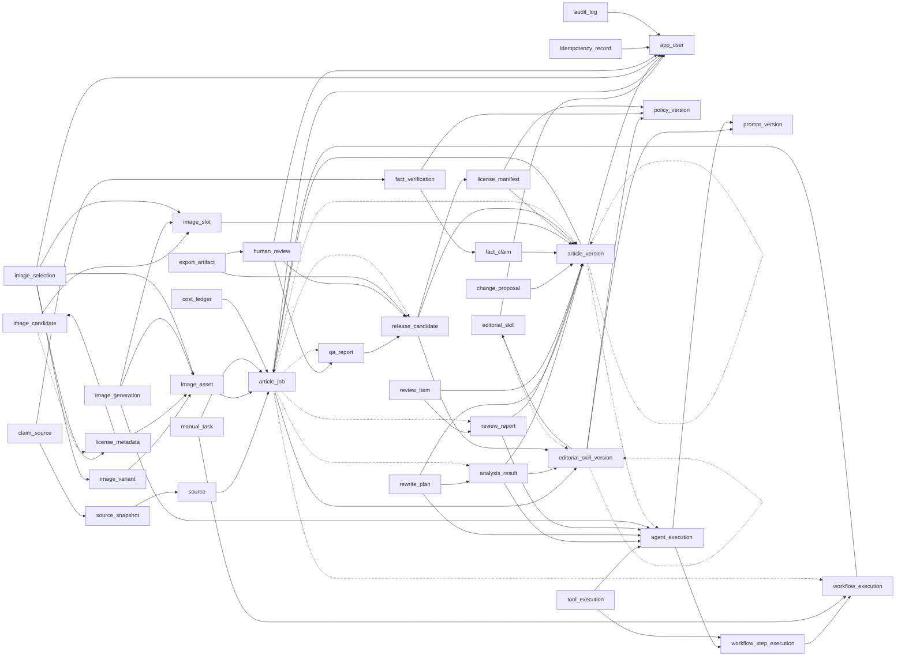

# 表归属及 FK 图（候选）

完整字段/索引/权限见 tables.json；实线是普通建表依赖，虚线是后置安装的延迟 FK。运行时引用环不等于模块编译环。

| 表 | 唯一拥有者 | 运行时写权限 |
|---|---|---|
| app_user | T03 | OPTIMISTIC_LOCK_AND_AUDIT |
| editorial_skill | T05 | OPTIMISTIC_LOCK_AND_AUDIT |
| editorial_skill_version | T05 | DRAFT content editable; published content immutable; retire status only |
| policy_version | T05 | DRAFT editable; published rules immutable; retire status only |
| prompt_version | T05 | DRAFT editable; published templates immutable |
| article_job | T06 | OPTIMISTIC_LOCK_AND_AUDIT |
| article_version | T06 | INSERT_ONLY |
| analysis_result | T12 | INSERT_ONLY |
| rewrite_plan | T13 | INSERT_ONLY |
| fact_claim | T16 | INSERT_ONLY |
| fact_verification | T17 | INSERT_ONLY |
| source | T15 | OPTIMISTIC_LOCK_AND_AUDIT |
| source_snapshot | T15 | INSERT_ONLY |
| claim_source | T17 | INSERT_ONLY |
| review_report | T14 | INSERT_ONLY |
| review_item | T14 | OPTIMISTIC_LOCK_AND_AUDIT |
| change_proposal | T07 | OPTIMISTIC_LOCK_AND_AUDIT |
| image_slot | T19 | OPTIMISTIC_LOCK_AND_AUDIT |
| image_candidate | T24 | OPTIMISTIC_LOCK_AND_AUDIT |
| image_asset | T23 | OPTIMISTIC_LOCK_AND_AUDIT |
| image_variant | T23 | INSERT_ONLY |
| image_generation | T25 | OPTIMISTIC_LOCK_AND_AUDIT |
| license_metadata | T22 | INSERT_ONLY |
| image_selection | T24 | Only active may UPDATE; new caption/variant/license -> new row |
| license_manifest | T26 | INSERT_ONLY |
| release_candidate | T27 | INSERT_ONLY |
| qa_report | T27 | INSERT_ONLY |
| human_review | T28 | INSERT_ONLY |
| manual_task | T11 | OPTIMISTIC_LOCK_AND_AUDIT |
| workflow_execution | T10 | OPTIMISTIC_LOCK_AND_AUDIT |
| workflow_step_execution | T10 | OPTIMISTIC_LOCK_AND_AUDIT |
| agent_execution | T09 | OPTIMISTIC_LOCK_AND_AUDIT |
| tool_execution | T09 | OPTIMISTIC_LOCK_AND_AUDIT |
| cost_ledger | T08 | OPTIMISTIC_LOCK_AND_AUDIT |
| idempotency_record | T03 | OPTIMISTIC_LOCK_AND_AUDIT |
| export_artifact | T29 | OPTIMISTIC_LOCK_AND_AUDIT |
| audit_log | T03 | INSERT_ONLY |
| provider_config | T09 | OPTIMISTIC_LOCK_AND_AUDIT |

